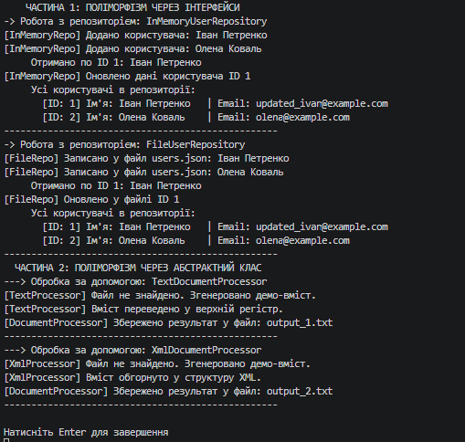

### Тема
Абстрактні класи та інтерфейси. Контракти та реалізації.

Варіант 1
1. IRepository та DocumentProcessor
   - IRepository<T> (інтерфейс): GetById(int id), Add(T item), Update(T item), Delete(int id).
   - InMemoryUserRepository (реалізація): зберігає об'єкти User у пам'яті (List<User>).
   - FileUserRepository (реалізація): зберігає об'єкти User у JSON-файлі.
   - DocumentProcessor (абстрактний клас): abstract void LoadDocument(string path), abstract void ProcessContent(), void SaveDocument(string path).
   - TextDocumentProcessor (похідний): override LoadDocument(), override ProcessContent() (форматування тексту).
   - XmlDocumentProcessor (похідний): override LoadDocument(), override ProcessContent() (обгортання в XML).

### Хід роботи
1. Налаштовано Visual Studio Code та необхідні розширення.
2. Створено консольний проєкт lab10v1.
3. Реалізовано узагальнений інтерфейс IRepository<T> та два класи його реалізації (InMemoryUserRepository, FileUserRepository) для сутності User.
4. Створено абстрактний клас DocumentProcessor із конкретним методом SaveDocument() та два похідні класи (TextDocumentProcessor, XmlDocumentProcessor) з реалізацією абстрактних методів.
5. Продемонстровано поліморфну поведінку через колекції List<IRepository<User>> та List<DocumentProcessor> у методі Main().
6. Проєкт завантажено на GitHub.

### Результат
