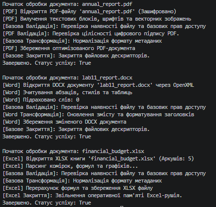

### Тема
DocumentProcessor: шаблонні кроки й реалізації.

Варіант 1
1. DocumentProcessor (Обробка документів)
   - DocumentProcessor (абстрактний клас): Process() -> Open(), Parse(), Validate(), Transform(), Save(), Close().
   - PDFProcessor (похідний): реалізація Open(), Parse(), Save() та перевизначення Validate() для PDF.
   - WordProcessor (похідний): реалізація Open(), Parse(), Save() та перевизначення Transform() для DOCX.
   - ExcelProcessor (похідний): реалізація Open(), Parse(), Save() та перевизначення Close() для XLSX.

### Хід роботи
1. Налаштовано Visual Studio Code та необхідні розширення.
2. Створено консольний проєкт lab11v1.
3. Реалізовано абстрактний клас DocumentProcessor із шаблонним методом Process(), який викликає послідовність з 6 кроків (поєднання abstract та virtual методів).
4. Створено 3 похідні класи (PDFProcessor, WordProcessor, ExcelProcessor), які реалізують обов'язкові абстрактні методи та специфічні віртуальні кроки.
5. Продемонстровано роботу шаблонного методу через поліморфний список List<DocumentProcessor> у методі Main().
6. Проєкт завантажено на GitHub.

### Результат
