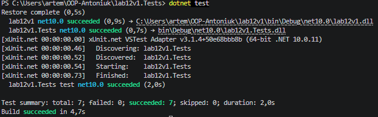

### Тема
Узагальнені типи (Generics). IRepository з where-обмеженнями та тестами.

Варіант 1
1. Узагальнений репозиторій та сутність Product
   - IEntity (інтерфейс): базова сутність із властивістю Id.
   - Product (клас сутності): реалізація IEntity з властивостями Name, Price, Stock.
   - IRepository<T> (узагальнений інтерфейс): CRUD-операції з обмеженням where T : IEntity.
   - InMemoryRepository<T> (реалізація): зберігання даних у колекції List<T> із обробкою виключень при роботі з неіснуючими елементами.

### Хід роботи
1. Налаштовано Visual Studio Code та необхідні розширення.
2. Створено консольний проєкт lab12v1 та проєкт для юніт-тестів lab12v1.Tests.
3. Реалізовано базовий інтерфейс IEntity та клас сутності Product.
4. Створено узагальнений інтерфейс IRepository<T> та його реалізацію InMemoryRepository<T>.
5. Написано 7 юніт-тестів (xUnit) для перевірки методів Add, GetById, GetAll, Update, Delete. Всі тести пройдено успішно.
6. Продемонстровано роботу репозиторію через екземпляр InMemoryRepository<Product> у методі Main().
7. Проєкт завантажено на GitHub.

### Результат
