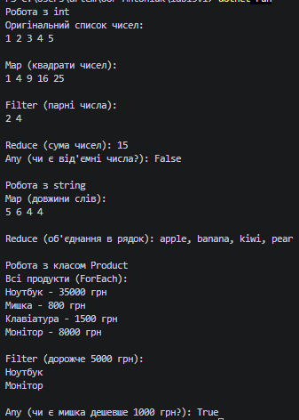

### Тема
Generic-методи для повторного використання компонентів: Mapper/MaxBy/Reduce з Func/Action.

Варіант 1
1. Узагальнені методи та функціональні інтерфейси
   - Функції вищого порядку: використання делегатів `Func<T, TResult>`, `Action<T>` та `Predicate<T>`.
   - `Map`: перетворення списку `List<T>` в `List<TResult>`.
   - `Filter`: фільтрація колекції за умовою.
   - `Reduce`: згортання списку до одного значення.
   - `ForEach`: виконання дії над кожним елементом.
   - `Any`: перевірка наявності хоча б одного елемента, що задовольняє умову.

### Хід роботи
1. Створено консольний проєкт `lab13v1` у середовищі Visual Studio Code.
2. Додано файл `.gitignore` для коректної роботи з репозиторієм.
3. Реалізовано статичний клас `FunctionalUtils`, який містить 5 generic-методів (`Map`, `Filter`, `Reduce`, `ForEach`, `Any`) відповідно до варіанту.
4. Створено користувацький клас `Product` з властивостями `Name` та `Price` для тестування.
5. У методі `Main()` продемонстровано роботу створених generic-методів з різними типами даних: `int`, `string` та `Product`.
6. Використано лямбда-вирази для передачі логіки в узагальнені методи.
7. Проєкт компілюється без помилок, результати виведено в консоль, код завантажено на GitHub.

### Результат
