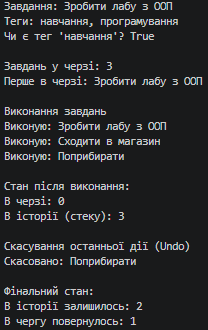

### Тема
HashSet/Queue/Stack: практичні сценарії.

Варіант 1
1. Система управління завданнями
   - `HashSet`: зберігання унікальних тегів для завдань.
   - `Queue`: черга завдань для виконання (FIFO - First In, First Out).
   - `Stack`: історія виконаних завдань для реалізації відміни операцій Undo (LIFO - Last In, First Out).

### Хід роботи
1. Створено консольний проєкт `lab14v1` у середовищі Visual Studio Code.
2. Файл `.gitignore` розміщено в корені репозиторію для коректної роботи з Git.
3. Створено користувацький клас `MyTask` з властивостями `Title` (назва завдання) та `Tags` (колекція `HashSet<string>` для унікальних тегів).
4. Продемонстровано роботу `HashSet`: додавання тегів та ігнорування дублікатів.
5. Продемонстровано роботу `Queue`: додавання завдань у чергу (`Enqueue`) та їх почергове виконання (`Dequeue`).
6. Продемонстровано роботу `Stack`: збереження історії виконаних завдань (`Push`) та відміна останньої дії (`Pop`) з поверненням завдання назад у чергу.
7. У методі `Main()` виведено в консоль усі етапи роботи колекцій для наочності.
8. Проєкт компілюється без помилок, результати виведено в консоль, код завантажено на GitHub.

### Результат
