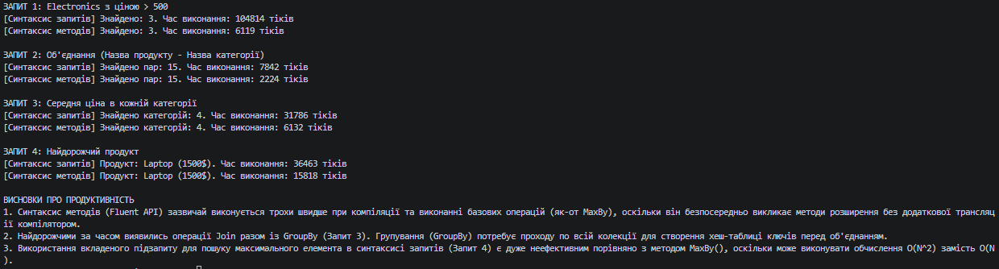

### Тема
LINQ в дії: фільтри, join, агрегації. Продуктивність.

Варіант 1
1. Сценарій: Інтернет-магазин.
   - Сутності: Product (Id, Name, Price, CategoryId), Category (Id, Name).
   - Запити:
     1. Знайти всі продукти в категорії “Electronics” з ціною > 500.
     2. Об’єднати продукти з їхніми категоріями, вивести назву продукту та назву категорії.
     3. Підрахувати середню ціну продуктів у кожній категорії.
     4. Знайти найдорожчий продукт.

### Хід роботи
1. Створено консольний проєкт `lab15v1` у середовищі Visual Studio Code.
2. Створено класи сутностей `Product` та `Category` і заповнено їх тестовими даними (понад 10 елементів).
3. Реалізовано 4 LINQ-запити згідно з варіантом. Для кожного запиту продемонстровано як синтаксис запитів (Query Syntax), так і синтаксис методів (Method Syntax).
4. Використано клас `System.Diagnostics.Stopwatch` для вимірювання часу виконання кожного запиту.
5. Проаналізовано продуктивність запитів:
   - Синтаксис методів зазвичай працює трохи швидше при виконанні базових операцій (наприклад, `MaxBy`).
   - Найдорожчими за часом виявилися операції групування (`GroupBy`) у поєднанні з `Join`, оскільки вони потребують створення хеш-таблиць та обходу всієї колекції.
   - Використання вкладених підзапитів для пошуку максимального елемента в синтаксисі запитів є менш ефективним, ніж використання спеціалізованих методів типу `MaxBy()`.
6. Проєкт компілюється без помилок, результати та час виконання виведено в консоль.

### Результат
