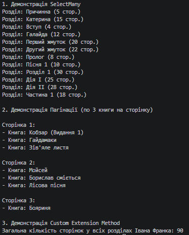

### Тема
LINQ: SelectMany, пагінація й custom extensions.

Варіант 1
1. Сценарій: Автори та їхні книги з розділами.
    - Сутності: `Author` (Id, Name, List), `Book` (Id, Title, List), `Chapter` (Id, Title, PageCount).
    - Запити:
      1. Отримати всі розділи всіх книг всіх авторів в одному списку (`SelectMany`).
      2. Вивести всі книги по 3 книги на сторінку (Пагінація).
      3. Створити метод розширення `TotalPages()` для `IEnumerable<Chapter>`, що обчислює загальну кількість сторінок (Custom Extension).

### Хід роботи
1. Створено консольний проєкт `lab16v1` у середовищі Visual Studio Code.
2. Створено класи сутностей `Author`, `Book` та `Chapter` і заповнено їх тестовими даними з вкладеними колекціями (понад 10 елементів).
3. Реалізовано 3 LINQ-запити згідно з варіантом. Для роботи з вкладеними колекціями продемонстровано використання оператора `SelectMany`.
4. Реалізовано механізм пагінації за допомогою методів `Skip()` та `Take()` для виведення списку книг посторінково.
5. Створено та застосовано власний метод розширення `TotalPages()` для типу `IEnumerable<Chapter>`, який інкапсулює бізнес-логіку підрахунку загальної кількості сторінок.
6. У коментарях до коду надано розгорнуті та обґрунтовані відповіді на контрольні запитання.
7. Проєкт компілюється без помилок, результати роботи всіх запитів виведено в консоль.

### Результат
