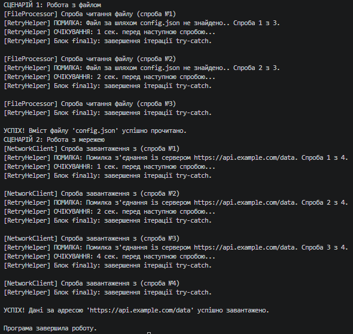

### Тема
Обробка IO/мережевих помилок та патерн Retry.

Варіант 1
1. Сценарій: Читання файлу.
   - Клас `FileProcessor`: Метод `string ReadFile(string path)`.
     - Імітувати `FileNotFoundException` перші 2 рази, потім успіх.
   - Клас `NetworkClient`: Метод `string DownloadData(string url)`.
     - Імітувати `HttpRequestException` перші 3 рази, потім успіх.
   - Делегат `shouldRetry`: Повторювати для `FileNotFoundException` та `HttpRequestException`.

### Хід роботи
1. Створено консольний проєкт `lab17v1` у середовищі Visual Studio Code.
2. Реалізовано класи `FileProcessor` та `NetworkClient`, які імітують роботу з файлами та мережевими запитами з генерацією відповідних винятків.
3. Створено узагальнений допоміжний клас `RetryHelper` з методом `ExecuteWithRetry<T>()` згідно з вимогами.
4. Реалізовано механізм експоненційної затримки (збільшення часу очікування між спробами за формулою) та логування кожної невдалої спроби.
5. Продемонстровано роботу в методі `Main`: створено сценарії, де операції завершуються тимчасовою невдачею, але успішно виконуються після кількох повторів.
6. Застосовано делегат `shouldRetry` для вибіркової обробки винятків (лише файлові та мережеві).
7. Проєкт компілюється без помилок, результати роботи виведено в консоль.

### Результат
