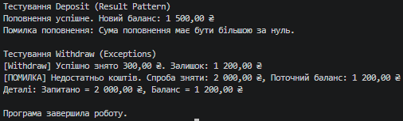

### Тема
Власні винятки та патерн Result.

Варіант 1
1. Сценарій: Банківські операції.
2. Власний виняток: `InsufficientFundsException (decimal RequestedAmount, decimal CurrentBalance)`.
3. Service: `AccountService`.
   - Метод `void Withdraw(decimal amount)`: Викидає `InsufficientFundsException`, якщо недостатньо коштів.
   - Метод `Result<decimal> Deposit(decimal amount)`: Повертає `Result.Success` або `Result.Failure` (якщо сума <= 0).

### Хід роботи
1. Створено консольний проєкт `lab18v1` у середовищі Visual Studio Code.
2. Створено власний виняток `InsufficientFundsException`, який успадковується від `Exception` та містить додаткові властивості `RequestedAmount` та `CurrentBalance`. Реалізовано стандартні конструктори.
3. Створено узагальнений клас `Result<T>` з полями `IsSuccess`, `Value`, `Error` та статичними фабричними методами для зручного створення об'єктів успіху та невдачі.
4. Реалізовано клас `AccountService` з методами `Withdraw` (викидає виняток при нестачі коштів) та `Deposit` (використовує патерн `Result` для валідації вхідної суми).
5. У методі `Main` продемонстровано обидва підходи: обробку винятку через `try-catch` та обробку результату через перевірку властивості `IsSuccess`.

### Результат
