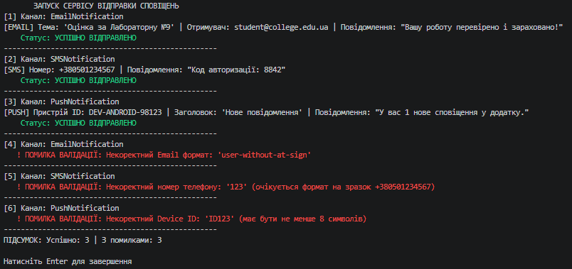

### Тема
Поліморфні сервіси: Notification (Email/SMS/Push).

Варіант 1
1. Система сповіщень: Notification -> EmailNotification, SMSNotification, PushNotification
   - Notification (базовий): Recipient, Message, abstract void Send(), abstract void Validate().
   - EmailNotification (похідний): Subject, override Send(), override Validate() (перевірка формату email).
   - SMSNotification (похідний): override Send(), override Validate() (перевірка формату телефону та довжини).
   - PushNotification (похідний): DeviceId, Title, override Send(), override Validate() (перевірка довжини Device ID).
   - Обробка помилок: Клас-сервіс NotificationService з методом SendAll(List<Notification>) та власне виключення NotificationException.

### Хід роботи
1. Налаштовано Visual Studio Code та необхідні розширення.
2. Створено консольний проєкт lab9v1.
3. Реалізовано ієрархію класів Notification, EmailNotification, SMSNotification та PushNotification із використанням абстрактних методів, їх перевизначення та валідації вхідних даних.
4. Створено клас NotificationService та продемонстровано поліморфний виклик методів, обробку винятків і роботу зі списком List<Notification> у методі Main().
5. Проєкт завантажено на GitHub.

### Результат
