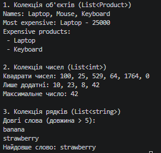

# Звіт до Самостійної роботи №10
**Тема:** Делегати й лямбда-вирази: власні утиліти для колекцій.

## Аналіз і порівняння з LINQ
1. **Чому делегати корисні для створення таких утиліт?**
   Делегати дозволяють передавати метод (поведінку) як параметр в інший метод. Це забезпечує відокремлення алгоритму обходу колекції від конкретної логіки обробки елементів. Замість того, щоб писати десятки методів `FilterByPrice`, `FilterByName`, ми пишемо один `Filter` і передаємо логіку через делегат.

2. **Як лямбда-вирази спрощують виклик цих методів?**
   Лямбда-вирази (наприклад, `p => p.Price > 1000`) дозволяють записувати логіку делегатів прямо в місці виклику ("inline"), без необхідності створювати окремі іменовані методи. Це робить код значно коротшим, більш читабельним і дозволяє замикати змінні з навколишнього контексту (closures).

3. **Порівняння власних методів з LINQ-операторами:**
   - `Map` виконує ту ж функцію, що й `Select`.
   - `Filter` є аналогом `Where`.
   - Основна відмінність реалізації: стандартний LINQ використовує "відкладене виконання" (lazy evaluation) за допомогою ключового слова `yield return`. Моя реалізація `Map` і `Filter` використовує "негайне виконання" (eager evaluation), оскільки одразу створює `List` і заповнює його, повертаючи готовий результат.
   - LINQ є частиною BCL та сильно оптимізований, проте написання власних методів допомагає глибоко зрозуміти принципи його роботи.

## Відповіді на контрольні запитання

1. **Чому делегати є зручним механізмом для передавання поведінки в узагальнені методи?**
   Вони забезпечують інверсію контролю. Узагальнений метод не знає, як порівнювати типи або які з них відбирати, він лише знає, *як* ітерувати. Делегат "навчає" узагальнений метод обробляти конкретні дані.

2. **У чому різниця між Func<T, TResult>, Action<T> та Predicate<T>?**
   - `Action<T>` приймає параметр типу `T` і нічого не повертає (`void`). Використовується для виконання дій (наприклад, виводу на екран).
   - `Func<T, TResult>` приймає параметр і повертає значення типу `TResult`. Використовується для трансформації або вибору властивостей.
   - `Predicate<T>` приймає параметр і повертає строго `bool`. Використовується для умов (чи підходить елемент). Є семантичним аналогом `Func<T, bool>`.

3. **Які переваги дає поєднання generic-методів і лямбда-виразів під час роботи з колекціями?**
   Це дає максимальну перевикористовуваність коду та сувору типізацію на етапі компіляції. Завдяки узагальненням ми не втрачаємо тип об'єкта, а завдяки лямбдам — пишемо мінімум "шаблонного" коду, отримуючи лаконічний і потужний інструментарій.

4. **У яких випадках власні утиліти на кшталт Map чи Filter корисно реалізувати самостійно, навіть якщо існує LINQ?**
   - Якщо ви розробляєте для середовища, де LINQ недоступний або заборонений (наприклад, специфічні ігрові рушії).
   - Якщо потрібно вбудувати додаткову логіку: власне логування кожного кроку ітерації, обробку винятків чи метрики.
   - Коли навмисно потрібно уникнути відкладеного виконання LINQ (`yield`) і гарантувати створення нової колекції в пам'яті під час самого виклику без додаткових `.ToList()`.

## Вивід консолі
