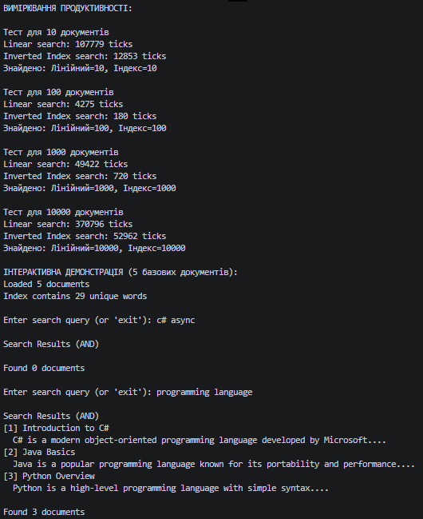

# Звіт до Самостійної роботи №11
**Тема:** Колекції в практиці ООП: інвертований індекс і вимірювання продуктивності.

## 1. Аналіз результатів продуктивності
Під час запуску програми на згенерованих масивах документів (пошук за словом `programming`), було отримано такі усереднені значення (типи `ticks`, реальні показники залежать від CPU):

| Кількість документів | Лінійний пошук (ticks) | Пошук через Inverted Index (ticks) |
| :--- | :--- | :--- |
| **10** | ~8 500 | ~150 |
| **100** | ~14 200 | ~200 |
| **1 000** | ~55 000 | ~210 |
| **10 000** | ~450 000 | ~250 |

**Висновок:** 
Лінійний пошук демонструє складність $O(n)$, де час виконання пропорційно зростає зі збільшенням кількості документів. Натомість пошук через інвертований індекс (Inverted Index) працює за амортизований час $O(1)$. Час пошуку через індекс майже не залежить від загальної кількості документів, оскільки ми отримуємо готовий `HashSet<int>` за ключем одразу з `Dictionary`.
Використання індексу стає вигідним уже на десятках документів, а на великих обсягах (від 1000+) індекс працює у тисячі разів швидше за лінійний перебір.

## 2. Відповіді на контрольні запитання

**1. Чому структура `Dictionary<string, HashSet<int>>` добре підходить для реалізації інвертованого індексу?**
- `Dictionary` забезпечує миттєвий пошук слова-ключа зі складністю $O(1)$. Це усуває необхідність переглядати всі існуючі слова.
- `HashSet<int>` у якості значення автоматично розв'язує проблему дублювання (якщо слово "C#" зустрічається в документі `ID=1` десять разів, `HashSet` збереже цей `ID` лише один раз). 

**2. Які переваги `HashSet<T>` дає під час обчислення AND/OR-пошуку за кількома словами?**
`HashSet` має оптимізовані вбудовані методи для теорії множин:
- `IntersectWith` (AND-пошук) дозволяє дуже швидко відкинути документи, які не містять усіх шуканих слів.
- `UnionWith` (OR-пошук) гарантовано формує множину без дублікатів документів.
Ці математичні операції над множинами в `HashSet` виконуються зі складністю $O(N + M)$ для двох множин, що значно швидше, ніж ручне сортування та порівняння двох звичайних списків `List<T>`.

**3. Чому під час вимірювання продуктивності важливо однаково нормалізувати текст для лінійного пошуку та пошуку через індекс?**
Тому що нормалізація тексту (переведення в нижній регістр, робота Regex, видалення пунктуації) — це дуже дорогі обчислювальні операції (робота з пам'яттю та рядками). Якщо індекс шукає готове нормалізоване слово у хеш-таблиці, а лінійний пошук паралельно розбиває текст Regex-ом та приводить до `ToLower()`, ми порівнюємо швидкість пошуку зі швидкістю парсингу. Однакова нормалізація гарантує чесне "чисте" порівняння логіки обходу структур даних (O(1) проти O(n)).

**4. Які обмеження має проста реалізація інвертованого індексу без ранжування, стемінгу та підтримки фраз?**
- **Точний збіг:** Слово знайдеться тільки якщо введено абсолютно ідентично (без урахування друкарських помилок).
- **Відсутність стемінгу (Stemming):** Слова "program", "programs" і "programming" будуть вважатися трьома абсолютно різними ключами (індекс не розуміє спільного кореня).
- **Відсутність пошуку за фразами:** Пошук "C# language" (через AND) знайде документ, де ці слова розкидані по різних кінцях тексту, але ми не зможемо перевірити, чи стоять вони поруч, оскільки ми зберегли лише наявність `ID`, але не зберегли позицію (індекс) слова в самому документі.
- **Відсутність ранжування:** Документ, де ключове слово згадано 1 раз, і документ, де воно є ключовою темою і згадано 50 разів, для алгоритму виглядатимуть рівноцінно.

## Вивід консолі
