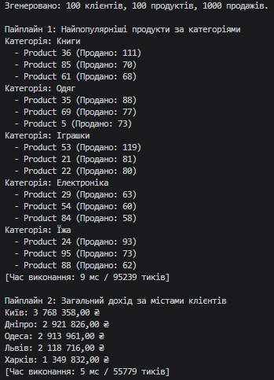
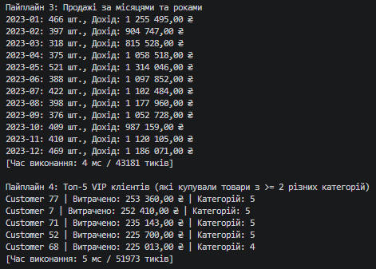

# Звіт до Самостійної роботи: LINQ pipelines (ETL та аналітика)

## 1. Опис реалізованих пайплайнів
- **Пайплайн 1: Найпопулярніші продукти за категоріями.** Використано `GroupBy` для агрегації кількості продажів за `ProductId`, потім `Join` з `Products` для отримання назв і категорій, знову `GroupBy` за категорією і вкладений `OrderByDescending` + `Take(3)` для вибору топ-3.
- **Пайплайн 2: Дохід за містами.** Використано подвійний `Join` (Sales -> Products -> Customers), щоб отримати і ціну, і місто. Далі `GroupBy` за містом, обчислення суми (`Sum`) і `OrderByDescending`.
- **Пайплайн 3: Продажі за роком та місяцем.** Використано створення анонімного об'єкта під час групування `GroupBy(x => new { x.SaleDate.Year, x.SaleDate.Month })`, що дозволяє агрегувати дані (`Sum`) за складним ключем і потім відсортувати (`OrderBy.ThenBy`).
- **Пайплайн 4: VIP клієнти.** Обчислює топ-5 клієнтів за витратами, але з умовою (`Where`), що вони купували товари мінімум з 2 різних категорій (використано `Distinct().Count()` всередині `Select` після групування).

## 2. Аналіз продуктивності
Час виконання кожного пайплайну (на 1000 записів продажів) становить близько **1-15 мс** (або кілька тисяч тиків процесора). 
**Фактори, що вплинули на продуктивність:**
1. **Відкладене виконання (Deferred Execution):** Таймер фіксував би ~0 мс, якби в кінці запиту не викликався метод `.ToList()`. Саме агрегуючі функції (`Sum`, `ToList`) змушують LINQ реально проходити по колекції.
2. **Операції Join:** `Join` у LINQ оптимізований (працює на основі хеш-таблиць), що дає складність O(N) замість O(N*M), як було б при використанні вкладених циклів чи `Where(x => ... == y...)`.
3. **Об'єм даних:** Створення великої кількості анонімних об'єктів під час `Select` або `Join` викликає виділення пам'яті (Memory Allocation) і навантажує Garbage Collector.

## 3. Відповіді на контрольні запитання
1. **Які переваги дає LINQ для побудови ETL-пайплайнів порівняно з ручними циклами?**
   LINQ робить код декларативним ("що зробити", а не "як зробити"). Замість десятків рядків з `foreach`, тимчасовими списками та словниками для групування, LINQ дозволяє описати трансформацію у вигляді одного лаконічного, зрозумілого ланцюга методів.

2. **Чому для аналітичних задач часто поєднують Join, GroupBy, Select та OrderBy в одному пайплайні?**
   Це класичні кроки ETL: витягнення зв'язаних даних з різних таблиць (`Join`), їх консолідація та агрегація за певними ознаками (`GroupBy` + `Sum/Count` всередині `Select`) і форматування кінцевого звіту для користувача (`OrderBy`).

3. **Які фактори можуть найбільше впливати на продуктивність складних LINQ-запитів?**
   - Багаторазове виконання відкладених запитів (якщо не закешувати результат через `.ToList()` чи `.ToArray()`).
   - Використання методів, що переривають потокову обробку (наприклад, `OrderBy` змушує LINQ завантажити всю колекцію в пам'ять перед тим, як віддати перший елемент).
   - Складність предикатів та надмірне створення проміжних анонімних об'єктів.

4. **Як перевірити, що LINQ-пайплайн не лише працює, а й залишається читабельним і підтримуваним?**
   - Правило форматування: один оператор LINQ — один рядок з відступом.
   - Уникнення глибокої вкладеності: якщо запит надто складний, його краще розбити на 2-3 проміжні змінні (оскільки LINQ відкладений, продуктивність від цього не впаде).
   - Використання промовистих імен для параметрів лямбда-виразів (не `x`, `y`, а `prod`, `sale`, `cust`).

## Вивід консолі
