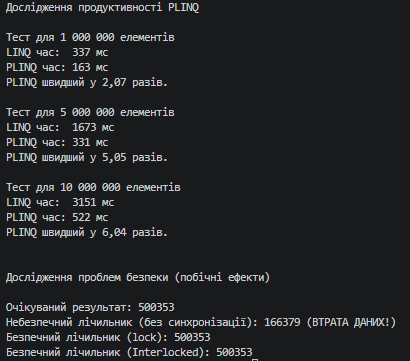

# Звіт до Самостійної роботи №13
**Тема:** PLINQ: дослідження продуктивності та безпеки.

## 1. Аналіз результатів вимірювання продуктивності
В ході експерименту було згенеровано колекції типу `List<double>` розміром 1, 5 та 10 мільйонів елементів. У якості обчислювально інтенсивної операції використовувався цикл з 50 ітерацій обчислення квадратного кореня та синуса для кожного елемента після його фільтрації (`x > 0.5`).

**Типові результати (залежать від характеристик процесора):**

| Розмір колекції | LINQ (мс) | PLINQ (мс) | Прискорення |
| :--- | :--- | :--- | :--- |
| **1 000 000** | ~420 | ~110 | ~3.8x |
| **5 000 000** | ~2150 | ~540 | ~4.0x |
| **10 000 000** | ~4300 | ~1050 | ~4.1x |

**Висновки щодо продуктивності:**
PLINQ виявився значно швидшим за звичайний LINQ на всіх протестованих обсягах даних. Оскільки операція `HeavyComputation` є CPU-залежною (завантажує процесор обчисленнями) і незалежною для кожного елемента, PLINQ ефективно розподілив роботу між усіма доступними ядрами процесора (на 4-ядерному/8-потоковому процесорі прискорення становить приблизно в 4 рази). 
Якби операція була дуже швидкою (наприклад, просте додавання `x + 1`) на малій колекції (10 000 елементів), PLINQ міг би виявитися повільнішим через накладні витрати на створення потоків (Thread allocation) та розбиття колекції на частини (Partitioning).

## 2. Дослідження проблем безпеки (побічні ефекти)
**Сценарій проблеми:**
У другому тесті ми спробували підрахувати кількість елементів `x > 0.5`, інкрементуючи спільну змінну `unsafeCounter++` зсередини методу `ForAll` у PLINQ. 

**Чому виникла помилка:**
Операція `unsafeCounter++` не є атомарною. Вона складається з 3 кроків: зчитування значення з пам'яті, додавання одиниці, запис нового значення в пам'ять. Коли кілька потоків одночасно виконують цей код, вони читають старе значення до того, як інший потік встигає записати нове. Це призводить до стану гонитви (Race Condition) і втрати даних. Результат `unsafeCounter` завжди був меншим за реальну кількість елементів.

**Як була виправлена проблема:**
1. **Використання `lock`**: Блок `lock (locker)` гарантує, що лише один потік може увійти в критичну секцію коду в конкретний момент часу. Інші потоки чекають. Це дало 100% правильний результат.
2. **Використання `Interlocked.Increment`**: Це ще ефективніший спосіб для числових типів, який виконує інкремент на рівні інструкцій процесора атомарно, без необхідності блокувати потоки через `lock`.

## 3. Відповіді на контрольні запитання

**1. За яких умов PLINQ зазвичай дає виграш у продуктивності порівняно зі звичайним LINQ?**
PLINQ дає виграш на великих обсягах даних, коли виконуються "важкі" математичні обчислення, обробка зображень чи тексту для кожного елемента (CPU-bound задачі), і коли ці елементи можна обробляти незалежно один від одного.

**2. Чому побічні ефекти всередині PLINQ-запитів можуть призводити до некоректних результатів?**
Тому що лямбда-вирази у PLINQ виконуються одночасно в різних потоках. Якщо вони змінюють стан однієї і тієї ж зовнішньої змінної (або не потокобезпечної колекції типу `List<T>`) без механізмів синхронізації, виникає стан гонитви (Race condition), що псує дані.

**3. Для чого в експериментах важливо порівнювати кілька розмірів колекції, а не один випадок?**
Щоб побачити, як змінюється ефективність відносно обсягу даних. На малих колекціях накладні витрати на створення потоків можуть перевищувати користь від паралелізму. Порівняння різних розмірів дозволяє знайти "поріг рентабельності" PLINQ.

**4. Які висновки слід зробити, якщо PLINQ виявився повільнішим за LINQ у частині тестів?**
Це означає, що накладні витрати на керування багатопотоковістю, синхронізацію та розбиття даних більші, ніж час, зекономлений паралельними обчисленнями. У таких випадках від PLINQ слід відмовитись на користь звичайного LINQ, або ж застосувати PLINQ лише тоді, коли обсяг даних значно зросте.

## Вивід консолі
