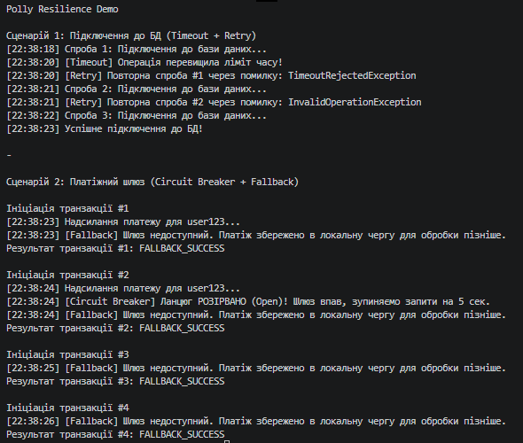

# Звіт до Самостійної роботи №14
**Тема:** Кейси Polly/Retry: короткий звіт.

## 1. Опис реалізованих сценаріїв

### Сценарій 1: Підключення до бази даних з плаваючими помилками
* **Проблема:** База даних іноді може довго відповідати через мережеві затримки або повертати помилки типу "Deadlock" через конкурентний доступ інших сервісів. Якщо запит зависає, це блокує потік програми.
* **Вибір політики Polly:** `Timeout` + `Retry`. 
  - `Timeout` розриває операцію, якщо вона триває довше визначеного часу (наприклад, 2 сек), щоб не блокувати потік назавжди.
  - `Retry` повторює спробу, якщо отримано помилку `TimeoutRejectedException` або помилку БД. Це ідеально для тимчасових (transient) збоїв.
* **Очікувана поведінка:** Перша спроба зависає -> спрацьовує Timeout -> Retry робить другу спробу -> друга спроба падає з Exception -> Retry робить третю спробу -> БД відповідає швидко і успішно.

### Сценарій 2: Перевантажений зовнішній платіжний шлюз
* **Проблема:** Сторонній API для обробки платежів повністю "впав" (повертає 503). Якщо ми продовжимо надсилати сотні запитів `Retry` на кожну транзакцію, ми лише погіршимо ситуацію (шлюз не зможе піднятися) і вичерпаємо власні ресурси очікуванням. Крім того, користувач не повинен бачити системну помилку.
* **Вибір політики Polly:** `Circuit Breaker` + `Fallback`.
  - `Circuit Breaker` після кількох підряд помилок переходить у стан *Open* і миттєво блокує всі наступні запити (на 5 секунд), даючи шлюзу час "перевести подих".
  - `Fallback` перехоплює помилку (як від самого запиту, так і `BrokenCircuitException` від відкритого Circuit Breaker'а) і повертає резервний результат (наприклад, "Платіж збережено в локальну чергу").
* **Очікувана поведінка:** Перші два запити падають з винятками шлюзу. Circuit Breaker розуміє, що шлюз лежить, розриває ланцюг. 3-й і 4-й запити навіть не намагаються стукати до шлюзу — вони миттєво перехоплюються Fallback-ом, економлячи час.

## 2. Висновки щодо використання Polly
Бібліотека Polly є критично важливою для побудови мікросервісів та сучасних розподілених систем. Вона дозволяє:
1. Відокремити бізнес-логіку від логіки обробки інфраструктурних збоїв.
2. Легко комбінувати політики (Pipeline), наприклад "спробуй 3 рази, але якщо загалом все падає — вимикай рубильник".
3. Підвищити стабільність системи, уникаючи каскадних збоїв (коли падіння одного сервісу кладе всі інші сервіси, які його чекають).

## 3. Відповіді на контрольні запитання
1. **Коли доцільно використовувати Retry, а коли - CircuitBreaker або Timeout?**
   - *Retry* — для "плаваючих" (transient) помилок, які можуть зникнути за мить (втрата пакету, тимчасове блокування таблиці).
   - *CircuitBreaker* — для тривалих збоїв, коли сервіс повністю недоступний. Немає сенсу бомбардувати його запитами; краще "вимкнути" зв'язок на певний час.
   - *Timeout* — коли операція зависає і не повертає ні результату, ні помилки, що загрожує витоком ресурсів потоку.

2. **Які переваги дає комбінування кількох стратегій у межах однієї ResiliencePipeline?**
   Це дозволяє створювати надійні ланцюги. Наприклад, `Fallback` -> `CircuitBreaker` -> `Retry` -> `Timeout`. Спочатку ми обмежуємо час одного запиту. Якщо він впав — пробуємо ще раз. Якщо впали всі спроби або ланцюг розірвався — ми повертаємо резервний варіант.

3. **Чому для навчальних сценаріїв важливо логувати кожну повторну спробу та результат виконання політики?**
   Оскільки Polly працює "прозоро" (як обгортка), без логів розробник не побачить, чи відпрацював запит з першого разу, чи після п'яти спроб. Логування (через `OnRetry`, `OnOpened` тощо) дозволяє моніторити реальний стан інфраструктури.

4. **Які ризики виникають, якщо застосувати політику повторних спроб до неідемпотентної операції?**
   Якщо операція неідемпотентна (наприклад, `POST /api/payments` — зняття коштів без унікального Id транзакції), то при мережевому збої під час отримання відповіді система може зробити `Retry`. Як наслідок, запит дійде до сервера двічі, і з клієнта спишуть гроші два рази. Для неідемпотентних операцій Retry можна робити лише за умови дуже обережного проектування (наприклад, використання ключів ідемпотентності).

## Вивід консолі
