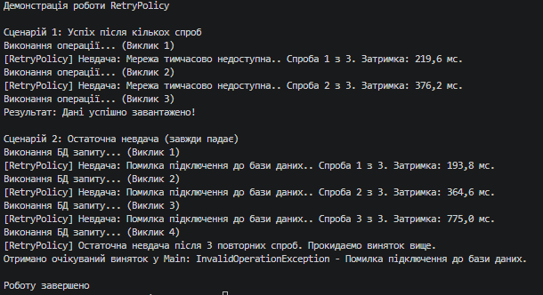

# Звіт до Самостійної роботи №15
**Тема:** Реалізація exponential backoff.

## Висновки щодо меж застосування патерну Retry з exponential backoff
Патерн Retry з експоненційною затримкою (exponential backoff) і випадковим відхиленням (jitter) є одним з найпотужніших механізмів відмовостійкості, проте він має свої межі:
1. Його доцільно застосовувати лише для **тимчасових (transient) збоїв** — наприклад, короткочасна недоступність мережі, тротлінг (rate limiting) зовнішнього API, дедлоки у БД.
2. Немає сенсу повторювати запити, які завершилися **перманентними помилками** (наприклад, 404 Not Found, 401 Unauthorized, синтаксичні помилки SQL) — вони не виправляться самі по собі з часом.
3. Експоненційна затримка може спричинити занадто довге очікування клієнта (блокування потоку). Наприклад, після 5-ї спроби затримка може складати десятки секунд. Тому Retry завжди потрібно обмежувати або комбінувати з Timeout.

## Відповіді на контрольні запитання

**1. Чому експоненційна затримка зазвичай ефективніша за фіксовану для тимчасових збоїв?**
Якщо зовнішній сервіс "ліг" від перенавантаження, фіксована затримка (наприклад, кожну секунду) продовжить бомбардувати його запитами з високою частотою, не даючи йому шансу відновитися. Експоненційна затримка зменшує навантаження на зламаний сервіс з кожною наступною спробою, "відступаючи" і даючи йому час піднятися.

**2. Для чого потрібен jitter і як він зменшує ризик одночасних повторних спроб?**
Якщо багато клієнтів одночасно зіштовхнуться зі збоєм, вони почнуть робити повторні спроби за однією й тією ж експоненційною формулою (через 1 сек, потім через 2 сек, 4 сек тощо). Це створить "хвилі" одночасних масових запитів (проблема Thundering Herd). Jitter вносить випадковість (±20%), тому всі клієнти зроблять наступну спробу розсинхронізовано (наприклад, один через 1.8 с, інший через 2.2 с), згладжуючи навантаження.

**3. Яку роль відіграє делегат shouldRetry у власній реалізації політики повторних спроб?**
Делегат `shouldRetry` дозволяє налаштувати вибірковість. Він відсіює фатальні помилки від тимчасових. Наприклад, ми повертаємо `true` для `TimeoutException` (і робимо Retry), але `false` для `UnauthorizedAccessException` (одразу прокидаємо помилку далі без повторних спроб, бо пароль від цього не стане правильним).

**4. У яких випадках повторна спроба не є безпечною та її слід заборонити?**
Повторні спроби небезпечні для **неідемпотентних операцій** без механізму дедуплікації. Наприклад, якщо клієнт відправив запит POST на зняття коштів з картки, запит успішно виконався на сервері, але відповідь загубилася в мережі. Клієнт отримає таймаут і зробить Retry, що призведе до подвійного списання коштів. У таких випадках потрібні ідемпотентні ключі або заборона автоматичних Retry для операцій зміни стану.

## Вивід консолі
