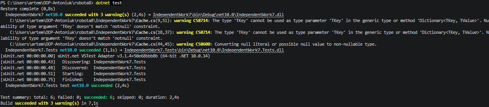

### Тема
Узагальнений кеш Cache<TKey, TValue> із тестами.

### Хід роботи
1. Створено консольний проєкт `IndependentWork7` та проєкт для тестів `IndependentWork7.Tests` у середовищі Visual Studio Code.
2. Налаштовано зв'язки між проєктами: додано посилання на основний проєкт з тестового.
3. Реалізовано узагальнений клас `Cache<TKey, TValue>`. Для збереження даних використано `Dictionary<TKey, TValue>`, а для відстеження порядку додавання елементів — `Queue<TKey>`.
4. Реалізовано політику витіснення FIFO: при перевищенні заданої ємності з черги вилучається найстаріший ключ, після чого він видаляється зі словника.
5. Написано юніт-тести для перевірки методів `Add`, `Get`, поведінки при переповненні, викидання `KeyNotFoundException` та роботи `ContainsKey`. Усі тести успішно пройдено.
6. У методі `Main` наведено демонстрацію роботи розробленого кешу при перевищенні ліміту.

### Контрольні запитання
1. **Які переваги надає `Cache<TKey, TValue>` порівняно з окремими неузагальненими реалізаціями кешу?**
   Узагальнення забезпечують сувору типізацію на етапі компіляції. Це позбавляє необхідності робити приведення типів (кастинг), запобігає помилкам невідповідності типів і значно підвищує продуктивність за рахунок уникнення операцій пакування та розпакування (boxing/unboxing) для значущих типів.

2. **Чому для реалізації політики FIFO зручно поєднувати `Dictionary<TKey, TValue>` з `Queue<TKey>` або `LinkedList<TKey>`?**
   `Dictionary` забезпечує миттєвий пошук та доступ (O(1)), але не гарантує збереження порядку. `Queue` ідеально підходить для FIFO, оскільки метод `Dequeue()` працює за O(1) і завжди віддає найстаріший доданий ключ. Їх поєднання дає швидкість словника і контроль хронології черги.

3. **У яких випадках метод `Get` повинен викидати `KeyNotFoundException`, а коли доцільніше використовувати підхід на кшталт `TryGetValue`?**
   `Get` повинен кидати виняток, коли за логікою програми відсутність ключа є критичною помилкою (дані гарантовано мають там бути). `TryGetValue` доцільніше використовувати, коли відсутність елемента — це очікувана штатна ситуація (наприклад, елемент вже був витіснений з кешу), яку треба швидко обробити без витрат ресурсів на генерацію винятків.

4. **Які тести є критично важливими для перевірки політики витіснення елементів з кешу?**
   Найважливішим є тест на переповнення ємності (граничний випадок). Потрібно перевірити, що після перевищення ліміту властивість `Count` не зростає, метод `ContainsKey` повертає `false` саме для найпершого доданого (найстарішого) елемента, а нові елементи успішно зберігаються.

### Результат
