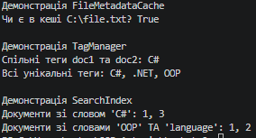

# Звіт до Самостійної роботи №9
**Тема:** Вивчення `Dictionary<TKey, TValue>` та `HashSet<T>` у бібліотеках .NET

## 1. Аналіз використання у відкритих проєктах (open-source)

### Приклад 1: Використання `Dictionary<TKey, TValue>` (Newtonsoft.Json)
- **Контекст:** У бібліотеці Newtonsoft.Json клас `DefaultContractResolver` використовує словник для кешування контрактів серіалізації (`Dictionary<Type, JsonContract>`). Це дозволяє уникнути повторного використання повільної рефлексії для одного і того ж типу.
- **Чому обрано:** Словник забезпечує миттєвий доступ `O(1)` до метаданих типу. `List` вимагав би лінійного пошуку `O(n)`, що критично уповільнило б серіалізацію мільйонів об'єктів.
- **Складність:** `O(1)` для читання і запису.
- **Особливі вимоги:** Оскільки серіалізація часто відбувається в багатопотоковому середовищі, там часто застосовують потокобезпечні обгортки над словником або `ConcurrentDictionary`.

### Приклад 2: Використання `HashSet<T>` (Entity Framework Core)
- **Контекст:** Під час відстеження змін в об'єктах (Change Tracker) EF Core використовує `HashSet<object>` для збереження списку вже відвіданих сутностей під час обходу графа об'єктів. Це запобігає зацикленню при кругових посиланнях (наприклад, Користувач -> Замовлення -> Користувач).
- **Чому обрано:** Потрібно лише швидко перевіряти, чи об'єкт вже оброблявся. Для цього потрібна тільки унікальність елементів і швидка перевірка `Contains`. 
- **Складність:** `O(1)` для `Add` та `Contains`.
- **Особливі вимоги:** Використовується специфічний `ReferenceEqualityComparer`, оскільки порівнювати об'єкти потрібно за посиланнями в пам'яті, а не за їхніми значеннями.

### Приклад 3: Комбінований підхід (Microsoft.Extensions.DependencyInjection)
- **Контекст:** У контейнерах впровадження залежностей (DI) часто необхідно зберігати кілька унікальних реалізацій для одного інтерфейсу (наприклад, `Dictionary<Type, HashSet<Type>>`).
- **Чому обрано:** Словник дозволяє швидко знайти базовий тип (інтерфейс), а `HashSet` в якості значення гарантує, що одна й та сама реалізація не буде зареєстрована двічі.
- **Складність:** `O(1)` для пошуку інтерфейсу + `O(1)` для перевірки унікальності реалізації.

## 2. Порівняльна таблиця складності операцій

| Операція / Структура | `List<T>` | `Dictionary<TKey,TValue>` | `HashSet<T>` | Коли використовувати |
| :--- | :--- | :--- | :--- | :--- |
| **Додавання** | `O(1)` (в кінець) | `O(1)` | `O(1)` | `List`: порядок важливий. `Dict/HashSet`: унікальність. |
| **Пошук за значенням**| `O(n)` | `O(n)` | `O(1)` | `HashSet` для швидкої перевірки існування елемента. |
| **Пошук за ключем** | N/A | `O(1)` | N/A | `Dictionary` для зіставлення ключа і значення. |
| **Видалення** | `O(n)` | `O(1)` | `O(1)` | `Dict/HashSet`, коли потрібно часто видаляти за ключем/значенням. |
| **Перевірка наявності**| `O(n)` | `O(1)` (за ключем) | `O(1)` | `HashSet` - ідеально для Contains. |

*Примітка: для `Dictionary` та `HashSet` вказана амортизована складність в ідеальному випадку. У разі великої кількості колізій хешів вона може деградувати до `O(n)`.*

## 3. Висновки
- **Коли `Dictionary` краще за `List`:** Коли дані мають природний унікальний ключ (ID, ім'я файлу) і вимагають частих операцій пошуку, оновлення чи видалення саме за цим ключем.
- **Коли `HashSet` є оптимальним вибором:** Коли потрібно зберігати лише унікальні елементи, виконувати математичні операції над множинами (перетин, об'єднання) або швидко перевіряти наявність елемента (фільтрація).
- **Підводні камені:** 
  1. Більші витрати пам'яті (через зберігання хеш-таблиць та бакетів).
  2. Порядок елементів не зберігається (якщо потрібен порядок, слід використовувати `OrderedDictionary` або алгоритмічне сортування після витягнення).
  3. Продуктивність критично залежить від якості методу `GetHashCode()`.

## 4. Контрольні запитання

**1. Які переваги generic-колекцій над неузагальненими структурами даних у .NET?**
Узагальнення (Generics) забезпечують сувору типізацію на етапі компіляції. Це виключає помилки несумісності типів (InvalidCastException), усуває необхідність постійного приведення типів (кастингу) та значно підвищує продуктивність за рахунок відсутності операцій пакування/розпакування (boxing/unboxing) для типів-значень.

**2. У яких сценаріях доцільніше використовувати Dictionary<TKey, TValue>, а в яких - HashSet<T>?**
`Dictionary` потрібен, коли між даними є зв'язок "ключ-значення" (наприклад, "ІД користувача -> Об'єкт користувача" або "Слово -> Кількість повторень"). `HashSet` доцільний, коли зв'язку немає, а є лише набір унікальних об'єктів і потрібно швидко перевіряти, чи належить об'єкт до цієї множини (наприклад, список заблокованих IP-адрес або унікальні теги).

**3. Як IEqualityComparer<T> впливає на коректність і продуктивність Dictionary та HashSet?**
Він визначає логіку порівняння двох об'єктів (метод `Equals`) та генерації їхнього хеш-коду (метод `GetHashCode`). Якщо порівнювач написаний некоректно, колекція може зберігати дублікати або не знаходити існуючі елементи. Якщо `GetHashCode` генерує однакові хеші для різних об'єктів (колізії), продуктивність пошуку деградує з `O(1)` до лінійної `O(n)`.

**4. Чому інвертований індекс зручно будувати саме на базі Dictionary<string, HashSet<int>>?**
Тому що словник (`Dictionary`) дозволяє за `O(1)` знайти потрібне слово (рядок) серед мільйонів інших, а значення у вигляді множини (`HashSet`) автоматично відкидає дублювання ID документів (якщо слово зустрічається в одному документі 10 разів, ID запишеться лише один раз) та дозволяє дуже швидко виконувати перетин результатів пошуку (метод `IntersectWith`) для пошуку за кількома словами одночасно.

## Вивід консолі
